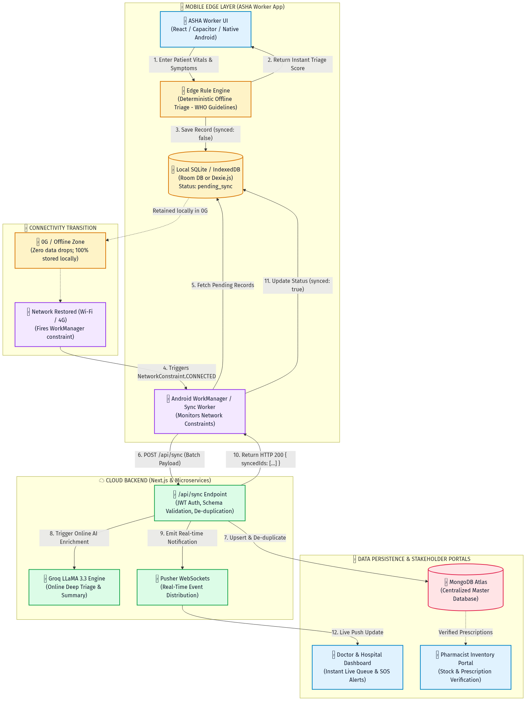
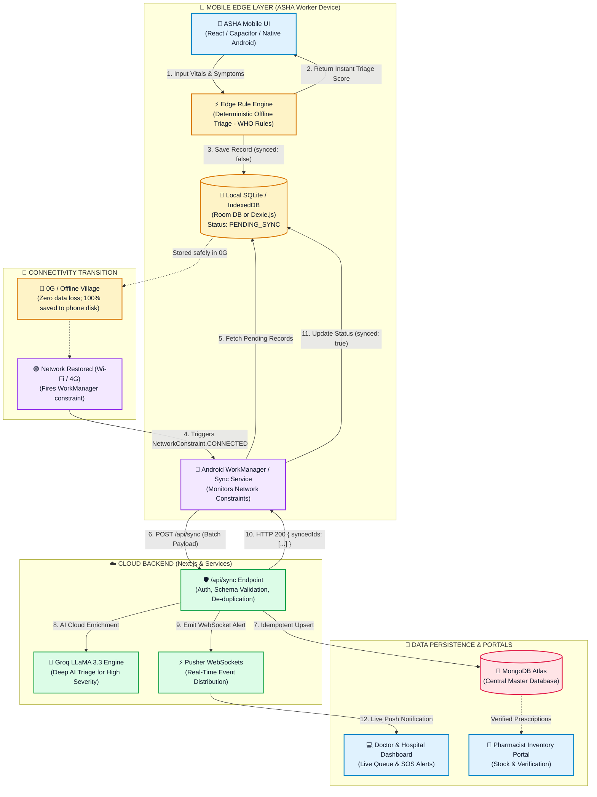
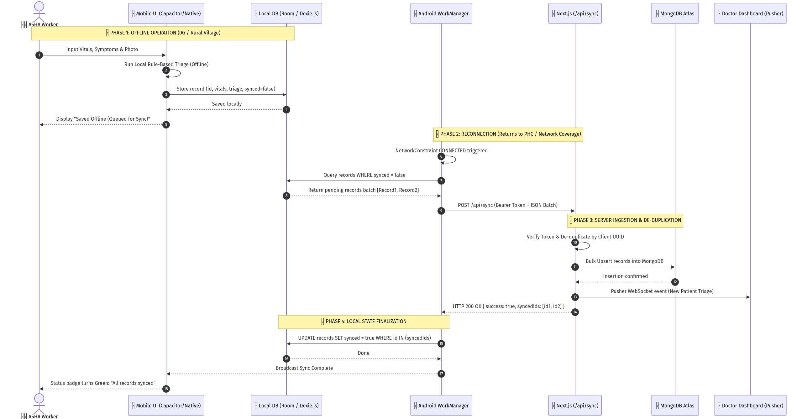
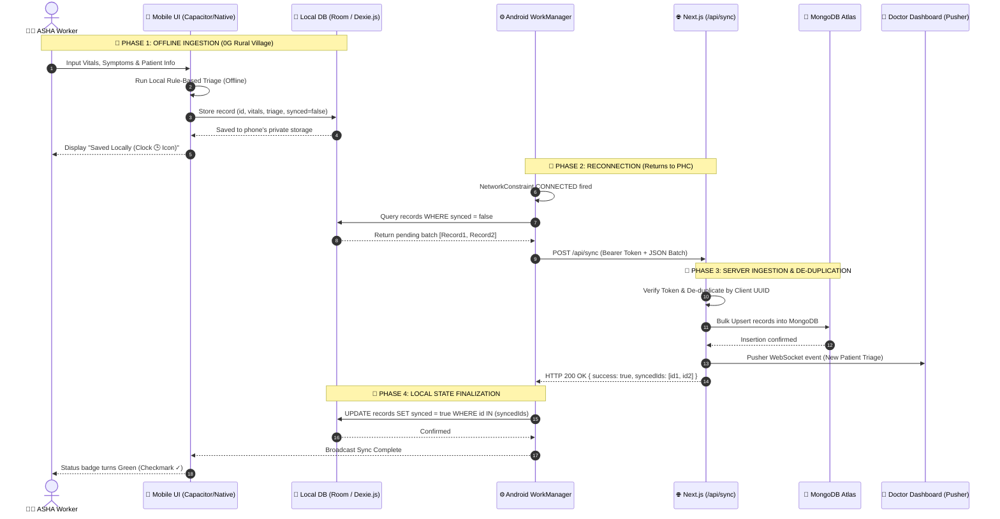

# 📱 Aarogya.AI — Offline-to-Online Architecture & Sync Engine

> **TL;DR for Team & GitHub Collaborators:**  
> This document explains how the ASHA worker app works in **0G / zero-connectivity rural areas** with **zero data loss**, functioning identically to how **WhatsApp chats** queue locally when offline and sync automatically upon reconnection.

---

## 💡 The WhatsApp Analogy (How to explain it in 30 seconds)

| Feature | WhatsApp Chat | Aarogya.AI Patient Triage |
| :--- | :--- | :--- |
| **When Offline (0G)** | You type and send a chat $\rightarrow$ shows **Clock icon** 🕒 | ASHA worker records patient $\rightarrow$ shows **"Saved Locally"** 🕒 |
| **Storage Location** | Local SQLite (`msgstore.db`) inside app sandbox | Local SQLite / IndexedDB (`Dexie.js` or `Room DB`) |
| **Reconnection (4G/Wi-Fi)**| Background service wakes up silently | Android **`WorkManager`** wakes up via `NetworkType.CONNECTED` |
| **Server Ingestion** | Uploads message $\rightarrow$ turns to **Single Checkmark** (✓) | Uploads batch to Next.js `/api/sync` $\rightarrow$ turns to **Synced** (✓) |
| **Stakeholder Action** | Recipient reads $\rightarrow$ **Double Blue Checkmark** (✓✓) | Pusher WebSocket alerts **Doctor / PHC Dashboard** in real time |

---

## 🛠️ Tech Stack & Responsibilities

1. **Client / Edge Layer**:
   - **Framework**: Next.js wrapped with **Capacitor.js** (or Native Android).
   - **Local Database**: **Dexie.js (IndexedDB)** for web/Capacitor or **Room (SQLite)** for Android.
   - **Edge Triage Engine**: Deterministic, rule-based clinical scoring (ICMR/WHO guidelines). *No heavy LLMs run on low-end phones!*
2. **Background Sync Engine**:
   - **Android WorkManager**: OS-level scheduler that monitors network state constraints (`CONNECTED`). Survives phone reboots, app task kills, and low battery states.
3. **Cloud Backend**:
   - **Next.js API Route**: `POST /api/sync` (Validates JWT, de-duplicates by Client UUID, bulk-upserts).
   - **Groq LLaMA 3.3 Engine**: Cloud-side deep triage analysis and clinical summary (only triggers when online).
   - **Pusher**: Real-time WebSockets dispatching high-severity alerts to doctors.
4. **Cloud Database**:
   - **MongoDB Atlas**: Central source of truth.

---

## 🔄 System Architecture Flow

---

## ⏱️ Step-by-Step Lifecycle (Sequence Diagram)

---

## 🔒 Security & Data Persistence Guarantees

1. **App-Private Storage (Sandbox)**:
   - Data is stored in `/data/data/com.aarogya.ai/databases/` (SQLite) or Chromium's private IndexedDB.
   - Other apps (WhatsApp, File Manager, Gallery) cannot access or tamper with patient medical records.
2. **Crash & Reboot Resilient**:
   - Written to non-volatile flash storage. If the phone battery dies in a village, zero data is lost.
3. **Idempotent Sync (No Duplicate Records)**:
   - Each record has a client-generated UUID `v4`.
   - The cloud uses MongoDB `bulkWrite` with `upsert: true` matching on `client_id`, ensuring poor network reconnect retries never duplicate patient entries.
