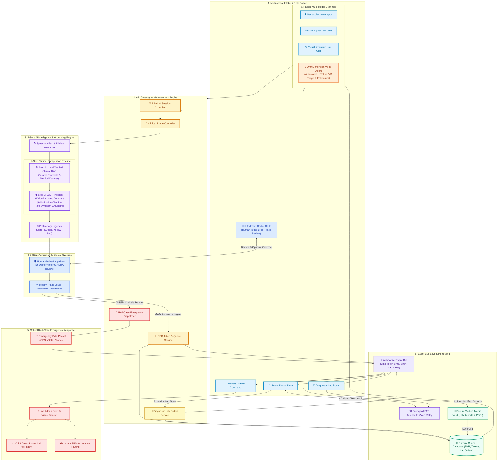

# 🏥 AROGYA.AI — MASTER TECHNICAL ARCHITECTURE, IMPLEMENTATION & CHANGELOG
**Version:** 2.4.0 (Production & Local Evaluation Ready)  
**Last Updated:** October 2026  
**Repository Path:** `d:\MajorPRoject\ArogyaAi\hackx-main\hackx-auth-final`  
**Permanent Reference Document:** This file serves as the single source of truth for all architectural designs, implementation sequences, recent bug fixes, and presentation slides.

---

## 📑 TABLE OF CONTENTS
1. [Recent Codebase Bug Fixes & Improvements](#1-recent-codebase-bug-fixes--improvements)
2. [Slide Section 1: Technical Architecture Diagram](#2-slide-section-1-technical-architecture-diagram)
3. [Slide Section 2: Implementation & Data Journey Flow](#3-slide-section-2-implementation--data-journey-flow)
4. [Slide Section 3: What Makes Our Technical Approach Unique?](#4-slide-section-3-what-makes-our-technical-approach-unique)
5. [Slide Section 4: Tech Stack Matrix with Badges](#5-slide-section-4-tech-stack-matrix-with-badges)
6. [Mobile Strategy: PWA Prototype ➔ React Native Production](#6-mobile-strategy-pwa-prototype--react-native-production)
7. [Master ChatGPT Prompts for All Quadrants](#7-master-chatgpt-prompts-for-all-quadrants)
8. [Local Running & Testing Instructions](#8-local-running--testing-instructions)

---

## 1. Recent Codebase Bug Fixes & Improvements

| Issue / Feature | Root Cause | Fix Applied | Files Modified |
| :--- | :--- | :--- | :--- |
| **Hospital Dashboard Appointment Disappearing on Reload** | Strict substring regex filter on `q.hospital` dropped older records or records tagged as `"Civil Hospital"` / undefined facility. | Broadened SION Apex hospital (`HOSP-SION-001`) matching to include general/civil/untagged records; added `.lean()` and `Cache-Control: no-store`. | `app/hospital/page.tsx`<br/>`app/api/consultations/route.ts` |
| **Patient Lab Reports & Records Missing** | Phone lookup only matched exact strings, missing 10-digit clean digit variants for patient Vignesh (`8591292159`). | Upgraded `app/api/lab-orders/route.ts` and `app/api/consultations/my/route.ts` with fuzzy 10-digit clean regex matching and no-store headers. | `app/api/lab-orders/route.ts`<br/>`app/api/consultations/my/route.ts` |
| **Records Page React Child Render Crash** | Diagnostic tests array contained object items `{ name: "...", code: "BLD" }`. React crashed when rendering `🧪 {test}` as an object child. | Sanitized test names as string primitives (`typeof t === 'string' ? t : t.name`); linked both Lab Orders and Diagnostic Blood Tests. | `app/records/page.tsx` |
| **Next.js Hydration Mismatch in `HomePage`** | `localStorage` and `window` were read during initial SSR render pass, causing HTML mismatch with client-side cached user state. | Added `mounted` lifecycle state; deferred `localStorage` reads to `useEffect`; added `suppressHydrationWarning` to `<html>` and `<body>`. | `app/home/page.tsx`<br/>`app/layout.tsx` |
| **AI Engine Clarification** | Stack clarified from legacy placeholder references to actual Groq LPU API. | Confirmed Groq LPU (`openai/gpt-oss-120b` / `llama-3.3-70b-versatile`) + Groq Whisper-Large-v3 + Local Clinical CSV RAG. | `lib/ai-triage.ts` |
| **NextAuth Production URL & Secret Resilience** | NextAuth failed or misdirected in production if `NEXTAUTH_URL` was set to localhost instead of the live Vercel domain. | Added resilient fallback secret in `authOptions` and documented setting `NEXTAUTH_URL` to the live Vercel domain in Vercel settings. | `app/api/auth/[...nextauth]/route.ts` |
| **Nerul & Kharghar Hospitals Added** | Added two major Navi Mumbai hospitals: D. Y. Patil Multi-Specialty Hospital (Nerul) & Kharghar Super-Specialty Civil Hospital. | Added `HOSP-NERUL-007` & `HOSP-KHAR-008` with live OPD counters, passkeys, doctor queues, and catchment areas. | `app/api/facilities/route.ts`<br/>`app/hospital/login/page.tsx`<br/>`app/hospital/page.tsx`<br/>`app/api/consultations/route.ts` |
| **Hospital Isolation & Private Appointment Privacy** | Appointments booked with private doctors or across unrelated hospitals were leaking into general hospital dashboards (e.g. Patiala appearing on Nerul). | Enforced strict `facilityId` scoping in `facilityScopedQueue`, MongoDB facility upsert synchronization, and location-ranked discovery in `/confirm`. | `app/hospital/page.tsx`<br/>`app/api/facilities/route.ts`<br/>`app/confirm/page.tsx` |

---

## 2. Slide Section 1: Technical Architecture Diagram
*(Pure System Architecture — Zero Third-Party Brand Clutter in Diagram Blocks)*



---

## 3. Slide Section 2: Implementation & Data Journey Flow

```mermaid
sequenceDiagram
    autonumber
    actor Patient as 👤 Patient (Voice / Text / Icons / Call)
    participant AI as 🧠 2-Step AI Comparison (RAG + Web)
    actor JrDoc as 👨‍⚕️ Jr./Intern Doctor (Verification)
    actor Admin as 🚨 Hospital Admin Command
    actor Doc as 🩺 Senior Doctor Desk
    actor Lab as 🧪 Diagnostic Lab
    participant DB as 💾 Database & Vault

    %% STAGE 1: INTAKE & 2-STEP AI COMPARISON
    Note over Patient,AI: Stage 1: Intake & 2-Step AI Comparison
    Patient->>AI: Submits symptoms (Voice/Text/Icons or Phone Call)
    AI->>AI: Step 1: Query Local Verified Clinical RAG
    AI->>AI: Step 2: Cross-compare with LLM / Medical Wikipedia & Live Web
    AI-->>JrDoc: Generate Preliminary Assessment & Urgency Score

    %% STAGE 2: 2-STEP VERIFICATION GATE
    Note over JrDoc,Admin: Stage 2: 2-Step Human-in-the-Loop Review
    JrDoc->>JrDoc: Reviews AI reasoning; can OVERRIDE urgency (e.g., Green ➔ Red)
    
    %% BRANCH A: RED CRITICAL EMERGENCY
    alt 🔴 RED CASE: Severe Emergency (Cardiac, Stroke, Trauma)
        JrDoc->>Admin: 🚨 Verified Emergency Signal dispatched
        Admin->>Patient: 📞 1-Click Direct Phone Call to Patient / Bystander
        Admin->>Patient: 🚑 GPS Ambulance Dispatched & ICU Bed Reserved
    
    %% BRANCH B: ROUTINE OPD & LAB FLOW
    else 🟢/🟡 GREEN or YELLOW: Standard OPD & Diagnostic Testing
        JrDoc->>DB: Lock Triage & Issue Live Token (#OPD-XXX)
        DB->>Admin: ⚡ Instant Token visible on Hospital Reception Dashboard
        Doc->>Patient: Conduct Encrypted WebRTC Video Consultation
        Doc->>DB: Prescribe Medications & Order Diagnostic Lab Tests
        
        %% LAB FULFILLMENT
        DB->>Lab: Order appears on Diagnostic Lab Portal
        Lab->>DB: Updates status ("Sample Collected" ➔ "Report Uploaded")
        DB->>Patient: 🔔 Instant Sync to Health Records (/records)
    end
```

---

## 4. Slide Section 3: What Makes Our Technical Approach Unique?

1. **🔬 2-Step AI Grounding & Comparison (RAG + Medical Wikipedia/Web):**
   - Eliminates AI hallucinations by cross-verifying patient symptoms in two steps: first against our **curated clinical RAG database**, and secondly against **live medical knowledge & medical Wikipedia sources** before calculating triage score.
2. **🛡️ 2-Step Human-in-the-Loop Clinical Verification:**
   - AI never acts as an unchecked final authority. Every AI-generated triage assessment and urgency score can be **reviewed, refined, or overridden by a Junior/Intern Doctor or ASHA supervisor** before final hospital routing.
3. **📞 OmniDimension Voice Agent (75% Automation):**
   - Conversational voice AI that handles ~75% of operations: telephone IVR triage, autonomous OPD slot booking, outbound post-consultation follow-ups, and medicine reminders.
4. **🚨 Zero-Latency Red-Case Emergency Protocol:**
   - Detects critical conditions in real time, bypassing queues to send an emergency packet (GPS coordinates, vitals, phone) to the Hospital Command Center for **1-click direct patient calling and instant ambulance dispatch**.
5. **🧪 Integrated Closed-Loop Diagnostic Lab Ecosystem:**
   - Prescriptions made during teleconsultations directly generate orders on diagnostic lab portals, supporting sample tracking and instant PDF report sync to patient health records.
6. **📱 Offline-First PWA with React Native Scale:**
   - Built as an offline-first **Progressive Web App (PWA)** for zero install friction in 2G rural areas, ready for seamless production transition to **React Native** (BLE medical sensors & background GPS).

---

## 5. Slide Section 4: Tech Stack Matrix with Badges

| Category | Technology & Component | Architectural Role | Official Badge |
| :--- | :--- | :--- | :--- |
| **Voice & Telephony AI** | **OmniDimension Voice AI** | Conversational voice calls, telephone IVR triage, automated follow-up calls (~75% automation) |  |
| **AI Inference & Speech** | **Groq LPU (GPT-OSS-120B / LLaMA) + Groq Whisper-v3** | Sub-second symptom triage, vernacular speech-to-text, clinical department routing |   |
| **2-Step AI Grounding** | **Clinical RAG + Medical Wikipedia / Web** | Dual-source symptom verification: cross-references local clinical guidelines with external medical databases to eliminate hallucinations |  |
| **Mobile Client Strategy** | **PWA (Prototype) ➔ React Native (Roadmap)** | **Phase 1 (PWA):** Offline Service Workers, 2G resilience, zero install friction.<br/>**Phase 2 (React Native):** Native BLE medical sensors, background GPS, lockscreen SOS. |  ➔  |
| **Web & API Gateway** | **Next.js 14 + TypeScript** | Serverless API routes, App Router, strict type-safe clinical models |   |
| **Database & Real-Time** | **MongoDB Atlas + Pusher WebSockets** | Document EHR store, 0ms live token counters, and emergency siren broadcasts |   |
| **Teleconsult & Vault** | **Daily.co (WebRTC) + Cloudinary CDN** | Encrypted peer-to-peer video rooms and secure cloud storage for lab reports/PDFs |   |

---

## 6. Mobile Strategy: PWA Prototype ➔ React Native Production

### Why PWA for Phase 1 (Working Prototype):
- **Zero Install Friction:** Patients in rural areas with low phone storage or poor internet can open the full app instantly via link/QR.
- **Offline-First Service Workers:** Caches patient EHR, previous prescriptions, and emergency helpline numbers in IndexedDB/CacheStorage for offline operation.
- **Unified Cross-Platform Codebase:** Single responsive Next.js frontend runs across Android, iOS, tablets, and desktop.

### Why React Native for Phase 2 (Production Scale):
- **Native Bluetooth Low Energy (BLE):** Direct hardware pairing with digital stethoscopes, pulse oximeters (SpO2), BP monitors, and 12-lead ECG patches.
- **Background Continuous GPS:** Enables real-time moving ambulance tracking even when the app is minimized.
- **Hardware SOS Hotkeys:** Trigger emergency SOS by double-pressing the physical power button when the phone is locked.
- **Zero Backend Rewrite:** Because our Next.js API Gateway, MongoDB, Groq AI, and Pusher WebSockets are headless REST/WebSocket microservices, the React Native app plugs in with 100% backend reuse.

---

## 7. Master ChatGPT Prompts for All Quadrants

```text
Act as a Principal Healthcare Systems Architect and Pitch Coach.

I am preparing the "Technical Approach" slide for "Arogya AI" (SIH Hackathon).

Generate the 4 complete slide sections:
1. Pure System Architecture Diagram (Mermaid) with Multi-Modal intake (Voice, Text, Visual Icons, OmniDimension Voice Agent 75% automation), 2-Step AI Grounding (RAG + Medical Wikipedia), 2-Step Clinical Verification (Jr Doctor override), Red-Case Emergency Dispatch (1-click calling + GPS ambulance), Doctor Teleconsult Desk, and Prescribed Lab Diagnostics.
2. Implementation Flow Diagram (Mermaid sequence) showing the end-to-end data journey.
3. 5 High-Impact Bullet Points for "WHAT MAKES OUR TECHNICAL APPROACH UNIQUE ??".
4. Tech Stack Table with Shields.io badges, explaining PWA prototype vs React Native roadmap.
```

---

## 8. Local Running & Testing Instructions

To run and evaluate the application locally without pushing or deploying to Vercel:

```bash
# Navigate to the project directory
cd d:\MajorPRoject\ArogyaAi\hackx-main\hackx-auth-final

# Verify TypeScript types
npx tsc --noEmit

# Start the local development server
npm run dev
```

- **Local Web App:** `http://localhost:3000`
- **Patient Dashboard & Triage:** `http://localhost:3000/home`
- **Hospital Admin & Emergency Command:** `http://localhost:3000/hospital`
- **Doctor Teleconsult Desk:** `http://localhost:3000/doctor/dashboard`
- **Diagnostic Lab Portal:** `http://localhost:3000/lab/dashboard`
- **Patient Health Records:** `http://localhost:3000/records`
