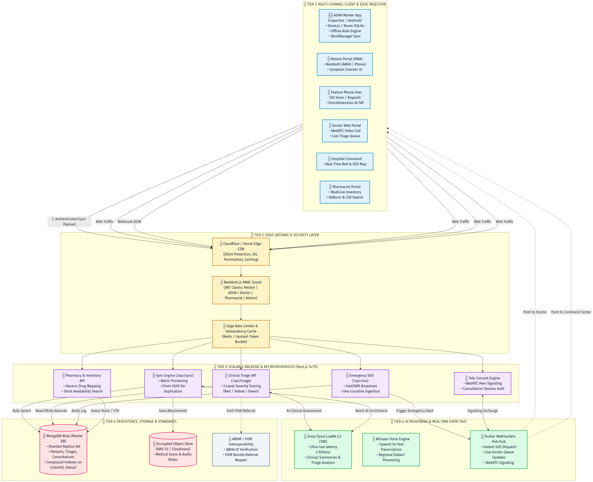
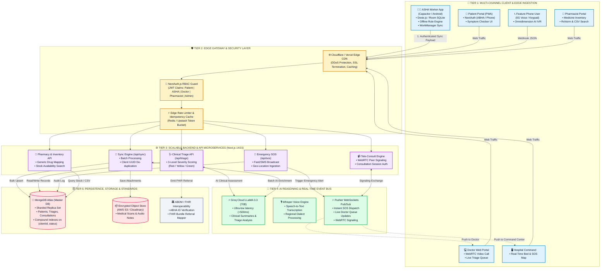

# 🏗️ Aarogya.AI v2 — Production & Scalable Technical Architecture

> **Executive Summary:**  
> Aarogya.AI is a multi-tier, offline-first rural health triage and tele-consultation platform. It bridges grassroots community health workers (ASHA) operating in **0G/low-bandwidth environments** with Primary Health Centres (PHCs), hospital command networks, and qualified medical doctors.

---

## 🖼️ Scalable Architecture Diagram





---

## 🎯 The Feasible Engineering Approach (Why this actually works)

### 1. Edge-First Feasibility (No Over-engineering)
- **Do NOT run 8B LLMs on cheap Android phones**: Running on-device models drains phone battery in 20 minutes and crashes on 2GB RAM devices.
- **Feasible Solution**: The edge app runs a **deterministic clinical rule engine** (WHO / ICMR red-flag symptom score). It executes in <5ms, works completely offline, and saves the result to `Dexie.js` or SQLite.
- When network coverage is restored, the cloud handles deep contextual triage using **Groq LLaMA 3.3 70B** in <500ms.

### 2. Zero-Loss WhatsApp-style Sync
- Every offline checkup creates a record with a client-generated UUID (`uuidv4()`) and `synced: false`.
- Android's native **WorkManager** listens to the OS network constraint (`NetworkType.CONNECTED`). When 4G/Wi-Fi is detected, it triggers in the background.
- Next.js `/api/sync` runs an **Idempotent Bulk Upsert** (`bulkWrite` in MongoDB). Even if network cuts out mid-upload and the app retries 5 times, **no duplicates are ever created**.

### 3. Safe Medical Scope (SIH / Hackathon Rule Compliance)
- **No AI Drug Prescriptions**: Aarogya.AI **never prescribes unverified medicines**. The pharmacy tier is an **inventory search and generic substitution tool** (querying verified CSV and RxNorm databases for what local PHC stores actually carry).
- Prescriptions are strictly authored by licensed medical officers during the WebRTC consultation.

### 4. Telemedicine at Scale (Low-Bandwidth WebRTC)
- Standard WebRTC peer connections with **Pusher WebSockets** for signaling.
- Audio-only fallback mode if bandwidth drops below 50 kbps, ensuring consultations continue even over erratic 2G/3G connections in rural clinics.

---

## 📋 Eraser.io Architecture Code (Ready to Paste)

```text
// TIER 1: MULTI-CHANNEL CLIENTS
Clients [icon: users, color: blue] {
  ASHA Worker Mobile App (Capacitor + Dexie.js) [icon: smartphone]
  Patient PWA (NextAuth + ABHA) [icon: globe]
  Feature Phone IVR (Omnidimension Voice) [icon: phone-call]
  Doctor Web Portal (WebRTC Video) [icon: user-check]
  Hospital Command Center [icon: monitor]
  Pharmacist Inventory System [icon: package]
}

// TIER 2: GATEWAY & SECURITY
Edge Gateway [icon: shield, color: purple] {
  Cloudflare / Vercel Edge CDN [icon: cloud]
  NextAuth.js Multi-Role RBAC [icon: lock]
  Redis Token-Bucket Rate Limiter [icon: zap]
}

// TIER 3: APPLICATION MICROSERVICES
Next.js Core Backend [icon: cpu, color: green] {
  /api/sync Idempotent Batch Engine [icon: refresh-cw]
  /api/triage 3-Level Severity Scorer [icon: activity]
  WebRTC Peer Signaling Engine [icon: video]
  /api/sos Emergency Broadcast Service [icon: alert-triangle]
  Pharmacy Stock & RxNorm Search [icon: search]
}

// TIER 4: AI & REAL-TIME EVENT BUS
AI & Event Bus [icon: radio, color: amber] {
  Groq LLaMA 3.3 70B Engine (<500ms) [icon: cpu]
  Whisper Multi-Dialect Audio Transcriber [icon: mic]
  Pusher Real-Time WebSockets [icon: activity]
}

// TIER 5: DATA PERSISTENCE & COMPLIANCE
Data & Standards [icon: database, color: red] {
  MongoDB Atlas Master Cluster [icon: server]
  Encrypted S3 Medical Blob Store [icon: hard-drive]
  ABDM / FHIR Referral Gateway [icon: file-text]
}

// CONNECTIONS
Clients > Edge Gateway: HTTPS / WSS
Edge Gateway > Next.js Core Backend: Authenticated Request
Next.js Core Backend > AI & Event Bus: Async LLM & Real-Time Events
Next.js Core Backend > Data & Standards: Bulk Upsert & Interop
AI & Event Bus > Clients: Instant Push Notifications & Signaling
```
