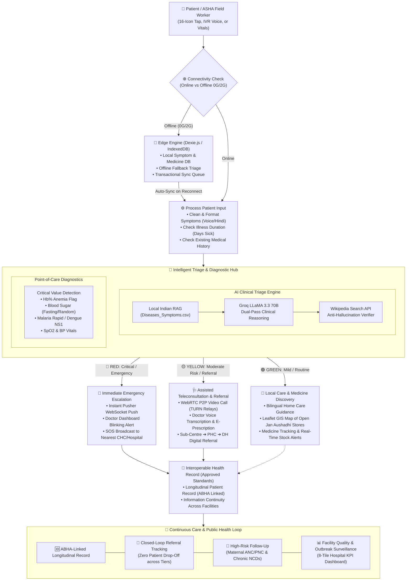

# 🏥 SMART INDIA HACKATHON 2025 — TECHNICAL APPROACH SLIDE
**Team Name:** Aarogya.AI (आरोग्य एआई)  
**Slide Title:** TECHNICAL APPROACH  
**Slide Format:** Official SIH 1-Slide Flow Diagram Layout (Sidebar + Decision Pipeline + Feedback Loop)

---

## 🖼️ 1. Slide Layout Blueprint (Visual Wireframe)

This wireframe mirrors the exact layout of your SIH slide template (Left Sidebar + Top Input + Edge/AI Engine + 3-Way Triage Decisions + Feedback Loop):

```
┌────────────────────────────────────────────────────────────────────────────────────────────────────────────────────────────────────────────────────────┐
│                                                               TECHNICAL APPROACH                                          [SIH 2025 LOGO]              │
├─────────────────────┬──────────────────────────────────────────────────────────────────────────────────────────────────────────────────────────────────┤
│ [TEAM LOGO]         │  (👤) Patient / ASHA Input ──➔ (⚙️) Edge Gateway & Connectivity Check                                                            │
│ Aarogya.AI          │  [16-Icons / Voice / Vitals]    [Auto-detects Online vs 0G/2G Offline]                                                           │
│                     │                                              │                                                                                   │
│ Techstack Used:     │                   ┌──────────────────────────┴──────────────────────────┐                                                        │
│ 1. Next.js 14 App   │                   ▼ [If Offline (0G/2G)]                                ▼ [If Online / Synced]                                   │
│    Router & React 18│       ┌───────────────────────────────┐                     ┌───────────────────────────────┐                                    │
│ 2. Groq LLaMA 3.3   │       │   Offline Engine (Dexie.js)   │                     │     Process Patient Input     │                                    │
│    70B (AI Triage)  │       │ • IndexedDB Local Storage     │                     │ • Clean & Format Symptoms     │                                    │
│ 3. Dexie.js (PWA    │       │ • Offline Triage Fallback     │                     │ • Check Illness Duration      │                                    │
│    IndexedDB Edge)  │       │ • Auto-Sync on Reconnect      │                     │ • Check Medical History       │                                    │
│ 4. MongoDB Atlas &  │       └───────────────┬───────────────┘                     └───────────────┬───────────────┘                                    │
│    Mongoose 8.23    │                       └──────────────────────────────┬──────────────────────┘                                                    │
│ 5. WebRTC & TURN    │                                                      ▼                                                                           │
│    (OpenRelay P2P)  │                         ┌──────────────────────────────────────────────────────────┐                                             │
│ 6. Pusher WebSockets│                         │                     AI & DIAGNOSTIC HUB                  │                                             │
│    (Real-time Push) │                         │  ┌─────────────────────────┐  ┌───────────────────────┐  │                                             │
│ 7. Leaflet / GIS    │                         │  │ AI Clinical Triage      │  │ Diagnostic Analyzer   │  │                                             │
│    (OpenStreetMap)  │                         │  │ • Local Indian RAG CSV  │  │ • Point-of-Care Flags │  │                                             │
│ 8. ABDM & HL7 FHIR  │                         │  │ • Groq LLaMA 3.3 70B    │  │ • Hb%, Sugar, SpO2,   │  │                                             │
│    (Standardization)│                         │  │ • Wikipedia Verifier    │  │   Dengue/Malaria Rapid│  │                                             │
│                     │                         │  └─────────────────────────┘  └───────────────────────┘  │                                             │
│ [Tech Badges]       │                         └────────────────────────────┬─────────────────────────────┘                                             │
│ Next.js · Groq      │                                                      │                                                                           │
│ MongoDB · WebRTC    │                        ┌─────────────────────────────┼─────────────────────────────┐                                             │
│ Pusher · Dexie      │                        ▼ [RED - Emergency]           ▼ [YELLOW - Moderate Risk]    ▼ [GREEN - Mild/Routine]                      │
│                     │             ┌──────────────────────┐      ┌──────────────────────┐      ┌──────────────────────┐                                 │
│ Prototype Link:     │             │ 🚨 Immediate Alert   │      │ 🩺 Assisted Telemed  │      │ 🌿 Local Care & Meds │      ┌────────────────────────┐ │
│ 🔗 Live Web App     │             │ • Instant Pusher Push│      │ • WebRTC Video Call  │      │ • Bilingual Home-Care│      │ Continuous Care Loop   │ │
│                     │             │ • Doctor Dashboard   │      │   with Doctor (TURN) │   ┌──┤ • Leaflet GIS Map of │      │ ┌────────────────────┐ │ │
│ Video Demo Link:    │             │   Blinking Animation │      │ • E-Prescription Gen │   │  │   Jan Aushadhi Stores│      │ │ Longitudinal ABHA  │ │ │
│ ▶️ YouTube Video    │             │ • Hospital Emergency │      │ • SC ➔ PHC ➔ DH      │   │  │ • Medicine Tracking  │      │ │ Health Record      │ │ │
│                     │             │   Escalation         │      │   Closed-Loop Refer  │   │  └──────────────────────┘      │ ├────────────────────┤ │ │
│                     │             └──────────┬───────────┘      └──────────┬───────────┘   │                                │ │ Closed-Loop        │ │ │
│                     │                        │                             │               │                                │ │ Referral Tracking  │ │ │
│                     │                        └──────────────────────┬──────┴───────────────┘                                │ ├────────────────────┤ │ │
│                     │                                               ▼                                                       │ │ High-Risk Follow-up│ │ │
│                     │                                   ┌───────────────────────────────┐                                   │ │ (ANC/PNC & NCDs)   │ │ │
│                     │                                   │ Interoperable Health Record   │──────────────────────────────────➔│ ├────────────────────┤ │ │
│                     │                                   │ • Approved Standards (ABDM)   │                                   │ │ Epidemic Heatmaps  │ │ │
│                     │                                   │ • Longitudinal Record (ABHA)  │                                   │ │ & Quality Monitor  │ │ │
│                     │                                   └───────────────────────────────┘                                   │ └────────────────────┘ │ │
│                     │                                                                                                       └────────────────────────┘ │
├─────────────────────┴──────────────────────────────────────────────────────────────────────────────────────────────────────────────────────────────────┤
│ @SIH Idea submission- Template                                                                                                                Slide 04 │
└────────────────────────────────────────────────────────────────────────────────────────────────────────────────────────────────────────────────────────┘
```

---

## 📐 2. Exact Mermaid Flowchart (Renderable / Editable)



---

## 📋 3. Detailed Slide Breakdown (Copy-Paste Text for PowerPoint)

### 👈 LEFT SIDEBAR (25% Width)

#### 1. Header & Team Logo
* **Logo:** Aarogya.AI Logo / MedTech Crest
* **Team:** Aarogya.AI

#### 2. Techstack Used:
1. **Next.js 14 (App Router) & React 18** *(Production Frontend & Serverless API)*
2. **Groq LLaMA 3.3 70B** *(Sub-second AI Clinical Triage)*
3. **Dexie.js & IndexedDB** *(Offline-First Edge Resilience)*
4. **MongoDB Atlas & Mongoose** *(Scalable Cloud Persistence)*
5. **WebRTC & OpenRelay TURN** *(Carrier NAT-Traversing Video Calls)*
6. **Pusher WebSockets** *(Real-Time Emergency Escalation Push)*
7. **Leaflet & OpenStreetMap** *(Jan Aushadhi Pharmacy GIS Mapping)*
8. **HL7 FHIR & ABDM Standard** *(Ayushman Bharat Interoperability)*

#### 3. Technology Badges / Icons:
* Next.js · React · Groq · MongoDB · WebRTC · Pusher · Tailwind CSS · ABDM

#### 4. Prototype & Video Links:
* **Prototype:** `https://arogya-ai-seven.vercel.app` *(or your project link)*
* **Prototype Video Link:** `[YouTube Demo Video Link]`

---

### 👉 MAIN FLOW CANVAS (75% Width)

#### Step 1: Input & Ingestion (Top)
* **Icon:** `(👤)` User / ASHA Worker
* **Text:** `Input: Symptoms / Vitals / SOS` (Captured via 16 visual icons, vernacular voice, or field diagnostics)
* **Arrow ➔ Gateway:** `Connectivity Detection`
  * **Branch A (Offline 0G/2G):** Routes to **Dexie.js IndexedDB**. Runs local offline triage fallback, stores records in client-side storage, and enters the **Transactional Sync Queue**.
  * **Branch B (Online):** Routes to **Process Patient Input** to clean & format symptoms (from voice/text), check illness duration (days sick), and read pre-existing medical conditions.

#### Step 2: Intelligent Triage & Diagnostic Hub (Middle)
* **Left Box: AI Clinical Triage**
  * *Step 1:* Vector retrieval on localized Indian medical dataset (`Diseases_Symptoms.csv`).
  * *Step 2:* Groq LLaMA 3.3 70B dual-pass clinical assessment in Hindi & English within 3 seconds.
  * *Step 3:* Real-time Wikipedia medical search cross-verification to prevent hallucinations.
* **Right Box: Diagnostic & Vitals Analyzer**
  * Evaluates ASHA-submitted point-of-care diagnostics (Hemoglobin %, Fasting/Random Blood Sugar, Malaria Rapid, Dengue NS1, SpO2, BP).
  * Automatically flags critical out-of-range physiological thresholds.

#### Step 3: Multi-Branch Decision Actions (Bottom-Center)
*(Direct equivalent to Benign / Malicious / Suspicious in the template)*

1. **🔴 RED (Emergency / Critical):**
   * *Trigger:* Severe chest pain, dyspnea, critical vitals, or panic SOS.
   * *Action:* **Immediate Emergency Escalation** via Pusher WebSockets. Triggers an audio-visual blinking alert on the Doctor/Hospital dashboard and alerts the nearest ambulance/CHC.
2. **🟡 YELLOW (Moderate Risk / Needs Evaluation 24–48h):**
   * *Trigger:* Persistent symptoms ≥ 3 days, abnormal vitals, or specialized consult required.
   * *Action:* **Assisted Teleconsultation & Tiered Referral**. Connects patient and ASHA worker to a specialist doctor via WebRTC video call with doctor AI-voice transcription and digital referral slip (Sub-Centre ➔ PHC ➔ CHC ➔ District Hospital).
3. **🟢 GREEN (Mild / Routine / Self-Care):**
   * *Trigger:* Common cold, mild seasonal fever, minor scrapes.
   * *Action:* **Local Care Guidance & Jan Aushadhi Discovery**. Provides bilingual self-care guidance and drops GIS pins on the closest open government Jan Aushadhi stores with live inventory.

#### Step 3.5: Interoperable Health Record Bridge (Approved Standards)
* **What it does:** Formats and saves the consultation into an official government-standard health record linked to the patient's **14-digit ABHA ID**.
* **Problem Statement Alignment:** Solves the core challenge of *"fragmented records and moving between Sub-Centres to District Hospitals without continuity of information"* by providing a standard **Longitudinal Patient Record**.

#### Step 4: Continuous Care & ABDM Governance Loop (Bottom-Right Box)
*(Direct equivalent to the "Continuous Learning Feedback Loop" in the template)*

* **Box Title:** `Continuous Care & ABDM Governance Loop`
* **4 Quadrants / Badges:**
  1. **Longitudinal ABHA Record:** Interoperable HL7 FHIR Bundle linked to patient ABHA ID.
  2. **Closed-Loop Referral Tracking:** Tracks patient from Sub-Centre to District Hospital until consultation completion (eliminating referral drop-offs).
  3. **High-Risk Cohort Registry:** Automated proactive tracking and visit reminders for Maternal Care (ANC/PNC) and Chronic NCDs (Hypertension, Diabetes).
  4. **Public Health Outbreak Surveillance:** 8-Tile Hospital KPI Dashboard tracking real-time symptom clusters for disease early-warning systems.

---

## 🎤 4. Presenter Pitch Script (Aligned Exactly with This Visual Flow)

> *"Respected Jury, this is our Technical Approach slide. Following our end-to-end flow from left to right:*
> 
> * **1. Multi-Modal Ingestion & Edge Resilience:**  
>   A patient or ASHA worker inputs symptoms via our 16-icon touch UI, IVR voice call, or field test data. In 0G or shadow zones, our **Dexie.js IndexedDB edge engine** takes over—running local fallback triage and queuing records for auto-sync.
> 
> * **2. Intelligent Clinical Hub:**  
>   Online data enters our dual-engine hub. Our **Groq LLaMA 3.3 pipeline** matches symptoms against a localized Indian dataset with RAG, cross-verifies with live clinical knowledge, and analyzes point-of-care vitals for critical thresholds.
> 
> * **3. Tri-Color Decision Stratification:**  
>   * If **RED (Critical)**: It immediately fires a WebSocket push to hospital dashboards with flashing alerts for emergency intervention.  
>   * If **YELLOW (Moderate)**: It initiates an assisted WebRTC teleconsultation with a doctor and generates a tiered referral from Sub-Centre to District Hospital.  
>   * If **GREEN (Mild)**: It delivers vernacular home-care guidance and maps nearby Jan Aushadhi pharmacies with real-time stock.
> 
> * **4. Continuous Care & ABDM Governance Loop:**  
>   Every consultation feeds into our ABDM-compliant HL7 FHIR engine. This creates a lifelong ABHA record, tracks high-risk maternal ANC/PNC cohorts, and provides hospital administrators with real-time epidemic surveillance heatmaps.*
> 
> *Thank you!"*

---

## 🎨 5. Styling & Visual Tips for PowerPoint / Google Slides

| Element | Color Palette / Hex | Icon / Shape Recommendation |
|---|---|---|
| **Left Sidebar** | `#F8FAFC` (Light Slate) or `#0F172A` (Dark Blue) | Rounded card with clean list & logo badges |
| **Edge Gateway** | `#3B82F6` (Electric Blue) | Diamond or rounded rectangle with gear icon `⚙️` |
| **AI Hub Container** | `#EEF2FF` border `#6366F1` (Indigo) | Double-border container enclosing RAG + Groq + Vitals |
| **RED Branch** | `#EF4444` (Alert Red) | Rounded card with blinking red icon `🚨` |
| **YELLOW Branch** | `#F59E0B` (Amber / Warning Yellow) | Rounded card with stethoscope / video icon `🩺` |
| **GREEN Branch** | `#10B981` (Emerald Green) | Rounded card with green shield / pharmacy icon `🌿` |
| **Continuous Loop Box** | `#1E293B` or `#F1F5F9` with circular loop arrow | 2x2 grid of pills with an upward feedback arrow `🔄` |
