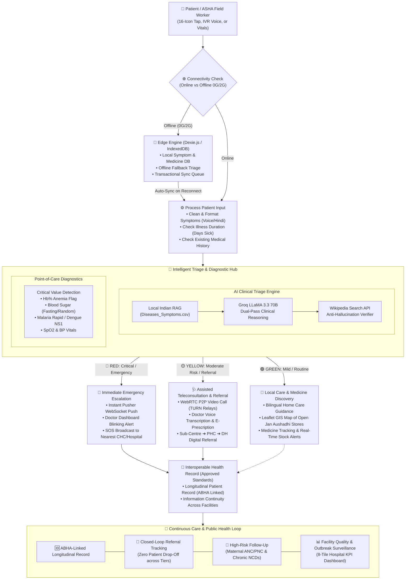

# 🏥 SMART INDIA HACKATHON 2025 — TECHNICAL APPROACH DIAGRAM

**Team Name:** Aarogya.AI (आरोग्य एआई)  
**Slide Title:** TECHNICAL APPROACH FLOWCHART & WIREFRAME  

---

## 🖼️ 1. Slide Layout Wireframe (ASCII Diagram)

```
┌────────────────────────────────────────────────────────────────────────────────────────────────────────────────────────────────────────────────────────┐
│                                                               TECHNICAL APPROACH                                          [SIH 2025 LOGO]              │
├─────────────────────┬──────────────────────────────────────────────────────────────────────────────────────────────────────────────────────────────────┤
│ [TEAM LOGO]         │  (👤) Patient / ASHA Input ──➔ (⚙️) Edge Gateway & Connectivity Check                                                            │
│ Aarogya.AI          │  [16-Icons / Voice / Vitals]    [Auto-detects Online vs 0G/2G Offline]                                                           │
│                     │                                              │                                                                                   │
│ Techstack Used:     │                   ┌──────────────────────────┴──────────────────────────┐                                                        │
│ 1. Next.js 14 App   │                   ▼ [If Offline (0G/2G)]                                ▼ [If Online / Synced]                                   │
│    Router & React 18│       ┌───────────────────────────────┐                     ┌───────────────────────────────┐                                    │
│ 2. Groq LLaMA 3.3   │       │   Offline Engine (Dexie.js)   │                     │     Process Patient Input     │                                    │
│    70B (AI Triage)  │       │ • IndexedDB Local Storage     │                     │ • Clean & Format Symptoms     │                                    │
│ 3. Dexie.js (PWA    │       │ • Offline Triage Fallback     │                     │ • Check Illness Duration      │                                    │
│    IndexedDB Edge)  │       │ • Auto-Sync on Reconnect      │                     │ • Check Medical History       │                                    │
│ 4. MongoDB Atlas &  │       └───────────────┬───────────────┘                     └───────────────┬───────────────┘                                    │
│    Mongoose 8.23    │                       └──────────────────────────────┬──────────────────────┘                                                    │
│ 5. WebRTC & TURN    │                                                      ▼                                                                           │
│    (OpenRelay P2P)  │                         ┌──────────────────────────────────────────────────────────┐                                             │
│ 6. Pusher WebSockets│                         │                     AI & DIAGNOSTIC HUB                  │                                             │
│    (Real-time Push) │                         │  ┌─────────────────────────┐  ┌───────────────────────┐  │                                             │
│ 7. Leaflet / GIS    │                         │  │ AI Clinical Triage      │  │ Diagnostic Analyzer   │  │                                             │
│    (OpenStreetMap)  │                         │  │ • Local Indian RAG CSV  │  │ • Point-of-Care Flags │  │                                             │
│ 8. ABDM & HL7 FHIR  │                         │  │ • Groq LLaMA 3.3 70B    │  │ • Hb%, Sugar, SpO2,   │  │                                             │
│    (Standardization)│                         │  │ • Wikipedia Verifier    │  │   Dengue/Malaria Rapid│  │                                             │
│                     │                         │  └─────────────────────────┘  └───────────────────────┘  │                                             │
│ [Tech Badges]       │                         └────────────────────────────┬─────────────────────────────┘                                             │
│ Next.js · Groq      │                                                      │                                                                           │
│ MongoDB · WebRTC    │                        ┌─────────────────────────────┼─────────────────────────────┐                                             │
│ Pusher · Dexie      │                        ▼ [RED - Emergency]           ▼ [YELLOW - Moderate Risk]    ▼ [GREEN - Mild/Routine]                      │
│                     │             ┌──────────────────────┐      ┌──────────────────────┐      ┌──────────────────────┐                                 │
│ Prototype Link:     │             │ 🚨 Immediate Alert   │      │ 🩺 Assisted Telemed  │      │ 🌿 Local Care & Meds │      ┌────────────────────────┐ │
│ 🔗 Live Web App     │             │ • Instant Pusher Push│      │ • WebRTC Video Call  │      │ • Bilingual Home-Care│      │ Continuous Care Loop   │ │
│                     │             │ • Doctor Dashboard   │      │   with Doctor (TURN) │   ┌──┤ • Leaflet GIS Map of │      │ ┌────────────────────┐ │ │
│ Video Demo Link:    │             │   Blinking Animation │      │ • E-Prescription Gen │   │  │   Jan Aushadhi Stores│      │ │ Longitudinal ABHA  │ │ │
│ ▶️ YouTube Video    │             │ • Hospital Emergency │      │ • SC ➔ PHC ➔ DH      │   │  │ • Medicine Tracking  │      │ │ Health Record      │ │ │
│                     │             │   Escalation         │      │   Closed-Loop Refer  │   │  └──────────────────────┘      │ ├────────────────────┤ │ │
│                     │             └──────────┬───────────┘      └──────────┬───────────┘   │                                │ │ Closed-Loop        │ │ │
│                     │                        │                             │               │                                │ │ Referral Tracking  │ │ │
│                     │                        └──────────────────────┬──────┴───────────────┘                                │ ├────────────────────┤ │ │
│                     │                                               ▼                                                       │ │ High-Risk Follow-up│ │ │
│                     │                                   ┌───────────────────────────────┐                                   │ │ (ANC/PNC & NCDs)   │ │ │
│                     │                                   │ Interoperable Health Record   │──────────────────────────────────➔│ ├────────────────────┤ │ │
│                     │                                   │ • Approved Standards (ABDM)   │                                   │ │ Epidemic Heatmaps  │ │ │
│                     │                                   │ • Longitudinal Record (ABHA)  │                                   │ │ & Quality Monitor  │ │ │
│                     │                                   └───────────────────────────────┘                                   │ └────────────────────┘ │ │
│                     │                                                                                                       └────────────────────────┘ │
├─────────────────────┴──────────────────────────────────────────────────────────────────────────────────────────────────────────────────────────────────┤
│ @SIH Idea submission- Template                                                                                                                Slide 04 │
└────────────────────────────────────────────────────────────────────────────────────────────────────────────────────────────────────────────────────────┘
```

---

## 📐 2. Renderable Mermaid Flowchart Diagram


